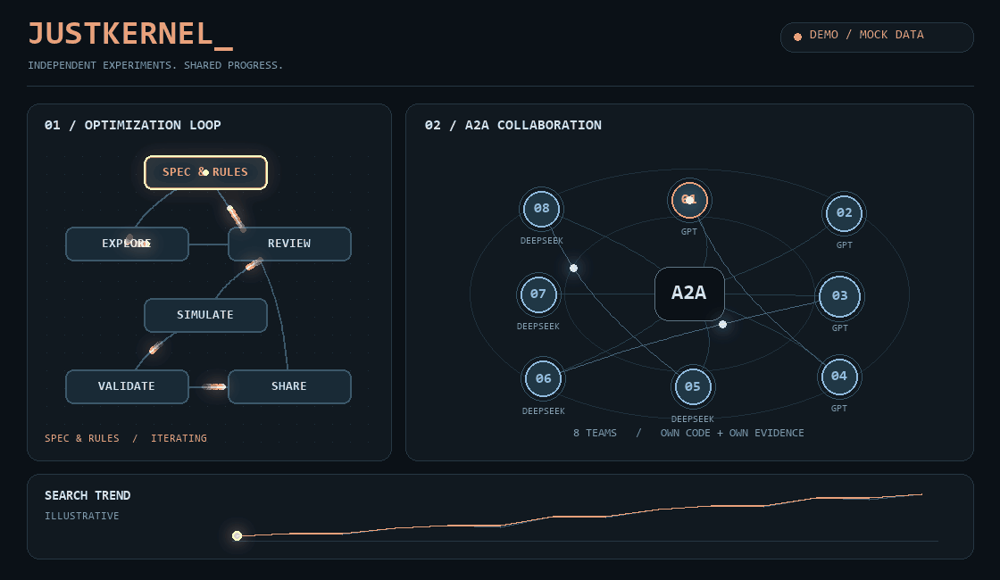
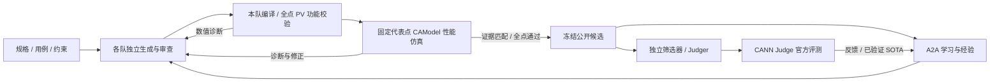

<div align="center">

# JUSTKERNEL

**让智能体独立实验，让有效优化彼此流动。**

An observable multi-agent lab for Ascend kernel engineering.

[](https://github.com/wuooo339/JustKernel/actions/workflows/ci.yml)
[](LICENSE)
[](pyproject.toml)



*内置预演页面实录：动态任务路径、A2A 协作与日志流。活动和曲线为模拟数据，不代表真实 NPU 耗时或官测成绩。*

[快速启动](#快速启动) · [模型配置](#模型配置) · [仿真与官测](docs/judge-only.md) · [参与开发](CONTRIBUTING.md)

</div>

JustKernel 将 **Deep Agents / LangGraph、A2A 通信、独立 CANN 仿真和精选官方评测**连接为持续优化闭环。每队维护自己的代码、技能、计划与检查点；先独立实验，再学习公开候选和反馈。搜索与官测同时推进，团队无需等待整个批次结束。

这是一个可运行的**研究预览版**。当前工程样例为 **ConfusionMulGrad**，从官方空工程导入开始，不附带私人的历史优化代码、模型凭据或官方隐藏输入。当前尚未取得该算子的官方全点通过成绩，不能将本项目视为已经完成比赛优化的成品。

## 快速启动

普通笔记本可先运行面板预演：支持主流 Windows、macOS、Linux，不要求独显、NPU、CANN、模型 Key 或官方算子工程。需要 Git 和 [uv](https://docs.astral.sh/uv/)，uv 会准备项目要求的 Python 3.13+ 与依赖；首次安装需要联网。

```sh
git clone https://github.com/wuooo339/JustKernel.git
cd JustKernel
uv run justkernel demo --open
```

打开 **http://127.0.0.1:4173/** 后自动播放预演，使用完整服务的同一套前端。轻量入口只提供模拟展示和记录导入导出，不创建团队工作区、不读取模型凭据、不连接官网或仿真器。Ctrl+C 停止；端口占用时加 `--port 4174`。依赖安装完成后，预演无需联网或 Node.js。

### 启动完整工作台

需要配置模型、团队、服务器或运行真实优化时：

```sh
uv sync --locked
cp .env.example .env
uv run python tools/import_official_template.py
uv run justkernel serve --open --supervise
```

完整工作台内仍可切换「真实运行」和「预演模式」，演示功能不需要单独的 Windows 启动文件。

官方模板单独下载到本机并核验 34 个文件，不纳入本仓库的 MIT 授权或发行包。也可先在[官方题目页](https://cannjudge.cn/public/ladder_october/confusionmulgrad)下载，再运行：

```sh
uv run python tools/import_official_template.py --zip /path/to/official-template.zip
```

`cp` 在 PowerShell、macOS 和 Linux shell 均可使用；复制 `.env` 时不要覆盖自己的现有配置。

随后也可用 `sh start.sh`、macOS 的 `start.command` 或 Windows 的 `启动演示.cmd` 启动。修改端口：`uv run justkernel serve --port 4174`。首次启动需要下载 Python 依赖和官方模板；完成后预演不调用模型。

## 查看团队的工作会话与反馈

真实模式下，左侧「任务规划」显示当前团队实际更新的 Todo，逐项显示待执行、进行中和完成；尚无 Todo 时显示登记的实验方案或实际调度待办。任务打勾不代表精度通过。中间保留 A2A 协作图，右侧按时间连续显示分析说明、工具请求与实际返回、源码差异和实验回执，工具名称直接可见、详情可展开。

任务以错落的分层节点呈现，运行中的节点有呼吸高亮和连接线光点；「动效开启 / 关闭」统一控制动画，不改变任务状态。实时日志只对新到达的事件播放入场与短暂高亮，首次加载和拖动回放不会把旧记录伪装成新事件。向下阅读历史时暂停插入，点击新事件提示恢复跟随；面板保留最近 160 条，其余记录仍在完整会话和导出中。

右侧「主队会话 / Judger 会话」同时切换任务清单和工作记录；Judger 可查看读取冻结源码、独立复核、选送、实际提交和完整官测回执。新增的 Judger 会话记录工具参数、返回、公开输出和实际调用时长，旧记录不补造缺失内容。「展开会话」放大阅读，「更早记录」加载历史，「跟随最新」恢复自动滚动。模型没有提供公开说明时会如实标注；调用时长与提供商返回的 Token 用量不代表内部推理时长。这里展示公开工作说明与技术假设，不采集模型私有推理。

「Judger → 本项目候选 → 完整官测结果」展示该提交的每一个测试点：结果、输出错误占比、用时、最优用时，并保留提交 ID 与源码 SHA256。团队的修正任务和 A2A 反馈包含同样的完整数据。时间按官方 API 的微秒单位转换显示，错误占比由有效精度比例换算；未提供的数据不会补成零。本地暂拟 INPUT 与官方隐藏测试的对应关系仍需独立确认。

## 官测驱动诊断

本地 INPUT 尚不能代表官方隐藏输入时，可在「Judger → 送测策略」选择「官测驱动诊断」。主队按完整官方回执登记假设、作通用修正，再用 `compile_kernel` 实际构建 Host/Kernel；独立 Judger 复核冻结源码后即可诊断提交，无需先等完整 CPU 数值仿真。编译通过只表示构建成功，候选明确标为“本地精度未全验证”；只有官方 Pass 才能成为官方 SOTA。默认策略保持兼容；启用仿真门槛时，正常模式仍要求同源码完整本地验证。

新版本的编译可以与该队旧冻结版本的数值仿真并行；每队仍只保留一个在途编译和一个数值实验，重复请求订阅原任务。编译、数值校验和送测分别绑定实际 Job ID、源码、输入包及执行器身份，后来的实验不会覆盖先前候选的证据。尚无官方冠军时，唯一活动主队的诊断候选若已获独立源码复核，却因筛选器结束时漏掉提名而停留，调度器会重新核对门槛后恢复送测；未复核、源码已变、构建被篡改或明确拒绝的版本不适用。

`propose_local_cases` 根据真实提交反馈增加单独的可复现探针，`list_local_cases` 查看原始用例与补充假设。探针可用于 `simulate_kernel`，拥有独立输入包哈希；不会替换原始 15 点、参考计算或精度标准。输出错误占比和耗时无法唯一确定隐藏张量；新增探针始终标为未确认假设，不编写按猜测测试点匹配的 Kernel。

每日上限留空表示不设本地次数上限，仍记录每次尝试、去重相同源码、串行收取官测反馈，并尊重平台实际返回的频率、登录及额度限制。新模式需更新 Linux Worker 后使用；历史仿真回执保留其原始执行器身份。

## 普通笔记本能运行哪些部分

| 使用方式 | 本机条件 |
| --- | --- |
| 面板预演、导入记录回放 | 普通 CPU + 浏览器，Windows / macOS / Linux；无模型或硬件调用 |
| 真实团队调用 GPT / DeepSeek 等 | 普通笔记本 + 可用模型 API / 网络；计算由模型服务承担 |
| 本地 CANN 指令仿真 | 另需兼容 Linux/CANN 环境及足够内存、磁盘；Windows 可使用已验收的 WSL2 路径 |
| NPU 实机测试 | 连接具备匹配环境的昇腾服务器，本机不要求安装 NPU |

重型仿真不属于“任意笔记本都能轻量运行”的范围。实验槽位与模型并发可按资源调整；每个逻辑 Device 的性能采集仍保持独占。

## 能做什么

| 能力 | 当前状态 |
| --- | --- |
| 统一模型 Harness | 所有团队与成员使用 Deep Agents，支持技能、Todo、子任务、工具循环与独立检查点 |
| 多模型组队 | GPT / DeepSeek；可添加 Qwen 等兼容 API，自动编号、均衡分配，成员可独立选模型 |
| 持续团队 PK | 最多注册 100 队；模型并发、仿真槽位和设备队列分别控制，不等于同时运行百队 |
| 独立仿真 | Linux/CANN Worker 真实编译、910B4 仿真、数值校验、原始 trace 与逐点回执 |
| A2A 学习 | 消息、公开代码和带来源的条件经验；官测反馈持久化投递、确认与去重 |
| Judger | 登录后精选送测、跟踪真实提交与反馈；默认全局每日最多 50 次，上海时间零点换日 |
| 实时监督与回放 | 公开模型输出、工具步骤、Todo、提供商报告的 Token 用量；真实事件可导出、离线回放 |
| 可选 NPU | SSH 连接与逻辑设备队列；ConfusionMulGrad 实机 Profiler、多机设备池尚未验收 |
| 稀疏优化 | 保留扩展位置；本题未接入已验证的稀疏算法，不宣称稀疏加速收益 |

默认模型并发 **4**、仿真并发 **1**，设备占用上限 **8 队**。这些是独立资源限制，均不表示实际连接了对应数量的设备。Linux Worker 可设置 1–8 个并行实验槽，重叠编译和准备；同一个逻辑 Device 的性能采集保持单路独占。真实模式仅显示已配置模型对应的活动团队。

面板按当前模型显示团队名称，例如切换至 Qwen 后显示 `Qwen-001`；工作区与回执仍使用原团队 ID，保持源码、仿真与 A2A 消息关联。退出的团队从实时视图移除，代码与官测历史保留在折叠记录中。Judger 可单独选择已配置模型，重连和暂停后继续保留选择；同一份已送测源码不会自动重复提交。榜单分别标明历史最好和最近一次官测覆盖率。

## 模型配置

在面板「配置 → 模型」添加连接：填写 **提供商、实际可用的模型 ID、Base URL 和 API Key**，保存并测试。默认只创建、派发一支主队，先建立正确性基线；已有其他团队的源码与历史保留，不会自动参与运行。「任务设置」可选择主队及模型，明确切换到多队模式后才并行派发。

**Qwen 首次实现流程**：在配置中打开 **Qwen 3.8 Flash**，填写本机 API Key，保存并测试；进入「任务设置」，选择「单主队」及 Qwen，点击启动。预置模型为 `qwen3.8-flash`，接口为 `https://maas.qianwenaiapi.com/compatible-mode/v1`，推理强度默认 `low`，输出上限留空；需要深入分析时可在配置中提高推理强度，工具调度不必每次进行长推理。模型、接口与账号权限以[千问官方文档](https://platform.qianwenai.com/docs/developer-guides/getting-started/latest-model)为准。

主队先读取最近失败回执，每轮修一个问题并做针对性探针；探针通过后运行完整本地点与固定代表点仿真，再经独立审查、精选官测，根据真实反馈继续修正。认证错误或余额不足会暂停派发，修复并测试连接后可手动恢复，不会无限空转。单队与多队均使用同一验证门槛；本地通过不代表官方通过。

单主队模式由一个 Deep Agents coding agent 直接编辑工程并调用编译/仿真工具，不再默认重复委派分析员、开发员和审查员。冻结候选的审查由独立 Judger 完成；多队模式仍可按需使用职责明确的成员。A2A 用于团队间共享候选和真实反馈，不替代单队工程能力。

调度器把最新官测失败或冻结源码复核缺陷转成持久化修正任务。主队先用 `record_experiment_plan` 登记“失败证据、一个假设、具体改动、验证标准、本地 case_ids”，再直接改码；控制层记录实际源码 SHA 和实验回执，按 **探针 → 同版本完整验证 → 独立 Judger** 推进。官方隐藏 ID 与本地输入的对应关系仍未确认，不能用官方编号选择本地用例。纯阅读、写计划或消息送达不会被计为源码/实验进展；同一任务无进展后不会按相同证据自动重派，新回执、源码、评测环境或新的任务目标可以恢复推进。任务及实验轨迹可在面板查看和导出回放。

单队模式默认在 **12次模型响应或5分钟仍无源码变化或新实验**时给出一次纠偏提醒；达到24次或累计10分钟仍无进展时停止并暂停派发。检查发生在下一次模型调用前，允许当前回复和工具操作完成；整轮仍受任务超时约束。写分析文件和重复读取旧结果不会重置计数，源码、会话与已排队实验会保留。`AWORKER_LAB_BASELINE_IDLE_SECONDS` / `AWORKER_LAB_BASELINE_IDLE_CALLS` 可调整时间和首轮响应阈值；这不是模型输出长度限制。`read_simulation_results` 无论是否指定实验 ID，默认都返回结构化摘要；详细诊断使用 `section=log/profile` 按段读取，无需解析大份日志文件。

- **OpenAI / GPT**：使用自己账号可用的标准 API 模型。
- **DeepSeek**：使用 DeepSeek API；思考模式与工具历史由专用适配器处理。
- **Qwen**：预置千问平台 Qwen3.8-Flash，支持流式工具调用、工具轮次思考字段保留及提供商 Token 用量记录。
- **其他模型**：使用供应商提供的兼容 API；模型 ID、额外参数及额度以你的服务为准。

`models.toml` 仅是公开模板，模板里的模型名称不保证在所有账号可用。输出上限默认留空，由提供商决定；上下文窗口与单次输出上限是不同设置。

也可用本机 `.env` 注入标准 API Key（**不要提交**）：

```dotenv
AWORKER_LAB_PROVIDER_KEYS={"openai":"YOUR_KEY","deepseek":"YOUR_KEY"}
```

API Key 和 SSH 密码保存在项目之外的本机加密配置目录；`.env`、`models.local.toml`、运行记录和登录文件均排除在 Git 与发行包之外。可选 ChatGPT 登录兼容入口依赖固定版本的实验性适配器，**`auth.json` 不是 API Key**；公开部署建议优先标准 API。详见[配置与认证](docs/configuration.md)。

## 真实优化闭环



**ConfusionMulGrad 样例**包含规格说明、默认禁区、15 组暂拟输入、官方模板来源与编辑清单，以及独立编译 / 仿真适配器。官方共 15 个测试点，但隐藏 shape / 数值尚不完整公开：**本地 15 组与官方逐点对应关系未确认**，数量相同不表示输入相同。

每次实验先用 PVModel 校验全部选定输入，仅对固定的行、列、全归约代表点运行详细 `msopprof` 性能采集，避免为全部大输入生成流水图。功能参照执行题面的 FP32 PyTorch 运算，固定 CPU 版本与线程数并记录；它仍不保证与官测运行环境逐位一致。更新校验器后需重新实验，不能沿用旧适配器证据。

送测要求同队、同冻结源码与同输入包的全部 15 点功能校验及代表点性能仿真通过证据，并经过复核和独立提名；子集探针不能满足全点门槛。 完整仿真通过后，调度器自动核对当前源码并冻结候选，交给独立筛选器复核，不依赖主队再次发出提交指令。首页分别展示本地覆盖率与官测反馈；仿真流水明细按需读取，完整历史仍保存在执行日志中。Judger 不逐队轮流提交，而是精选挑战候选。只有官方 Pass 且优于当前冠军的回执才能更新已验证 SOTA。**仿真 cycle、真机耗时、官测分数分别记录**。

真实仿真需要另行安装匹配的 Linux/CANN 环境及仿真库；macOS / Windows 可运行面板，仿真应使用兼容 Linux 主机，Windows 已验证 WSL2 路径。无 NPU 时实机 Profiler 不运行；缺少仿真环境时不会伪造仿真结果或自动绕过提交门槛。[部署与使用说明 →](docs/judge-only.md)

## 一起开发

欢迎通过 Issue / PR 分工：**Harness 与模型、仿真与证据、Judger、A2A 与知识、面板与回放、算子适配**。建议每个任务一个分支、一个明确验收结果。请先阅读 [CONTRIBUTING.md](CONTRIBUTING.md)，遵守仓库中的人类维护 `AGENTS.md`。

```sh
uv run pytest -q
uv run ruff check src tests tools
uv run ruff format --check src tests tools
node --test tests/web_visualization.test.cjs tests/web_activity.test.cjs
uv build
uv run python tools/package_source.py
```

Node.js 只用于前端开发检查，不是面板运行依赖。CI 覆盖 Windows / macOS / Linux；模型、CANN、NPU 与官网验收需要另外的真实环境。[验证边界](docs/verification.md)

```text
src/aworker/lab/                  # Harness、调度、模型、证据、Judger、Web API
  resources/web/                 # 真实模式 / 预演 / 回放共用前端
  resources/skills/              # 工程、规则审查与证据蒸馏技能
  resources/confusion_mul_grad/  # 规格、暂拟用例、官方来源及导入后的本机工程
  resources/simulator/           # Linux/CANN 独立 Worker
src/aworker/server/               # A2A 服务端与协议
models.toml                      # 公开模型模板，无凭据
tools/                           # 官方模板导入、环境检查与源码打包
.justkernel/                     # 本机实验、日志与检查点；不公开
```

[系统设计](docs/architecture.md) · [配置](docs/configuration.md) · [仿真与官测](docs/judge-only.md) · [安全边界](SECURITY.md) · [第三方声明](THIRD_PARTY_NOTICES.md)

本项目面向可信本机开发，尚不提供恶意代码沙箱或公网多租户隔离。项目原创部分使用 **MIT**；官方模板、CANN 及其他第三方内容遵循各自条款。
