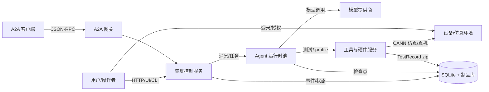
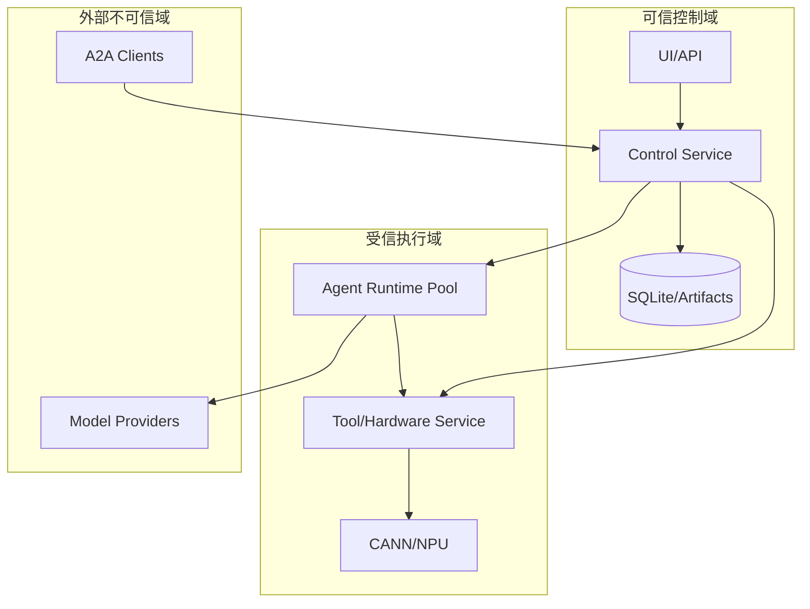

# 02 系统上下文与部署形态

> 上层：[01-product-vision.md](01-product-vision.md)  
> 下层：[03-architecture.md](03-architecture.md)

---

## 1. 上下文图



### 1.1 外部参与者

| 参与者 | 交互 | 信任级别 |
| --- | --- | --- |
| 用户/操作者 | 面板、CLI、配置、启动/停止 | 可信本机 |
| A2A 客户端 | 集群状态、消息、任务 | 默认本机/受信 |
| 模型提供商 | HTTPS | 外部不可信 |
| CANN 仿真/真机 | 编译、测试、profile | 受信执行环境 |
| 文件系统/制品库 | 源码、记录、事件 | 受信本机 |

---

## 2. 信任边界



规则：

| 边界 | 规则 |
| --- | --- |
| UI → Control | 同源/本机；写操作走用例；不直接读 DB |
| Control → Agents | 任务/消息带 ACL；agent 只能读自己有权的内容 |
| Agent → Tools | 工具按角色注册；worker 只能调用工作工具 |
| Worker → Board | **禁止**；只能通过 mentor 私有通道 |
| Consultant → Board | mentor board **只读**；consultant board 可写 |
| Tools → Hardware | 独占租约；队列共享；超时/取消 |
| 事件/日志 → 外部 | 统一脱敏；不含密钥/私有推理 |

---

## 3. 部署形态

### 3.1 多进程运行时（默认）

```text
┌─────────────────────────────┐
│ Cluster Control Service     │  API/SSE/A2A、角色注册、消息路由、
│                             │  任务调度、board、收敛、持久化
└──────────────┬──────────────┘
               │ 本地 RPC/消息总线
┌──────────────▼──────────────┐
│ Agent Runtime Pool          │  逻辑 agent 会话；进程池；
│ supervisor/consultant/      │  每 agent 独立检查点/工具权限
│ mentor/optimizer/tester/    │
│ profiler                    │
└──────────────┬──────────────┘
               │ 工具调用
┌──────────────▼──────────────┐
│ Tool & Hardware Services    │  编译、测试、profile、设备队列
└──────────────┬──────────────┘
               │
┌──────────────▼──────────────┐
│ Storage                     │  SQLite、事件日志、制品库、zip
└─────────────────────────────┘
```

- **控制服务**不跑模型；负责状态、路由、调度和审计。
- **Agent 运行时池**运行约 100 个逻辑 agent；一个 agent 不等于一个进程，池可扩缩。
- **工具/硬件服务**独立进程/服务；设备队列与租约集中管理。
- **存储**可嵌入控制服务，也可独立；通过端口访问。
- 单机可运行全部角色；多机时按控制面/运行时/工具面拆分。

### 3.2 运行模式

| 模式 | 用途 | 外部依赖 |
| --- | --- | --- |
| `demo` | UI 预演/回放 | 无模型/设备 |
| `cluster` | 真实集群 | 模型 + CANN 仿真/真机 |
| `worker` | 独立工具/硬件服务 | CANN/设备 |
| `migrate` | 旧数据导入 | 无网络 |

### 3.3 规模与并发

- `max_agents` 默认 100（逻辑 agent）。
- supervisor 1；consultant 建议 2–5；mentor 动态；worker 由 mentor 开/关。
- 模型并发、agent 并发、工具并发、硬件队列容量分别限制。
- 设备租约按设备 ID 独占；tester/profiler 共享队列但不共享租约。

---

## 4. 数据分类

| 数据 | 可见范围 |
| --- | --- |
| mentor board | supervisor、mentors 读写；consultants 只读 |
| consultant board | consultants、supervisor |
| worker channel | 对应 mentor + worker |
| hardware queue | tester/profiler + 工具服务；supervisor/mentor 只读队列摘要 |
| candidate source | 作者/所属 mentor、supervisor；已发布候选向同集群 mentors 开放；worker 只读任务授权快照 |
| TestRecord | 关联 agent/mentor/supervisor；导出需脱敏 |
| 密钥 | 仅模型/SSH/工具适配器；不进入 agent 上下文 |

---

## 5. 故障域

| 故障 | 影响 | 期望 |
| --- | --- | --- |
| Agent 崩溃 | 当前任务中断 | agent `FAILED`；mentor 可重派/重开 worker |
| Control 崩溃 | 消息/调度暂停 | 重启恢复；不自动重跑任务 |
| 工具服务崩溃 | 测试/profile 中断 | 核对原执行后清理租约，mentor 以新 Task 决定重派 |
| 设备掉线 | 队列阻塞 | 租约过期；设备隔离直到确认旧执行停止，重派使用新 Task |
| 模型限流/认证 | agent 无法继续 | 退避/暂停；人工修复 |
| 磁盘满 | 记录/事件写入失败 | 健康降级；停止新任务 |
| 消息重复 | 重复任务/结果 | 消息 ID 幂等 |

---

## 6. 外部接口

| 接口 | 方向 | 协议 | 规范 |
| --- | --- | --- | --- |
| UI/API | 双向 | HTTP/JSON + SSE | 09 |
| A2A | 双向 | JSON-RPC | 09 |
| 模型 | 出站 | HTTPS | 05/10 |
| 工具/硬件 | 双向 | 本地 RPC/队列 | 07 |
| 存储 | 本地 | SQLite/文件 | 08 |

---

## 7. 假设

- 一个集群只优化一个算子；不同算子用不同集群/数据目录。
- 用户提供 OperatorSpec（含可信 reference/oracle、输入及精度约束）、测试/ndjson 技能和设备配置；GENERATE 无需基线源码，IMPORT 才要求源码。
- 约 100 个逻辑 agent 是上限目标，不要求 100 个常驻模型会话。
- 首版 tester 用 CANN 仿真；真机通过同一 skill/tool 接口替换。
- 旧 `JustKernel` lab 数据只读迁移，不参与新集群。

## 8. 生成与跨集群服务边界

- 从零生成和迭代反馈统一遵守 [13 章](13-generation-and-iteration-contract.md)；reference、测试包和规则在优化前固化为只读制品。
- Control 拥有跨集群全局注册库，负责同 operator_id 活动集群的原子占位；每集群独立 journal.db 仅保证本集群约束。
- Tool/Hardware Service 拥有全局设备账本，跨集群统一队列、租约和物理执行确认；集群数据库中的租约仅为镜像。
- 本机多个进程必须使用同一注册服务/设备服务；多控制节点须接同一仲裁服务，禁止各自用独立 SQLite 冒充全局唯一性。
- 候选代码属于受信执行环境；本规格不提供恶意代码沙箱，但必须把工具凭据、参考和测试文件与 optimizer 可写工程分开。
