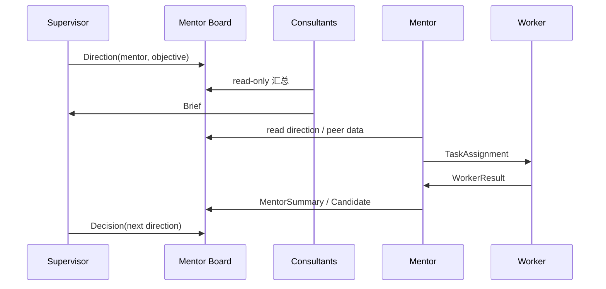
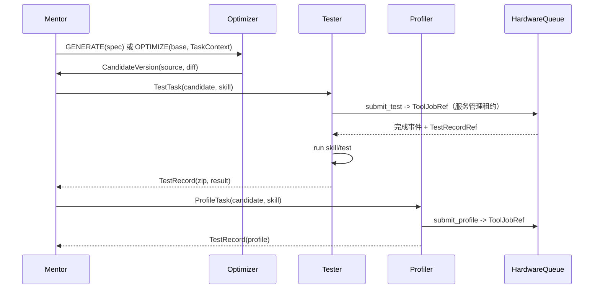
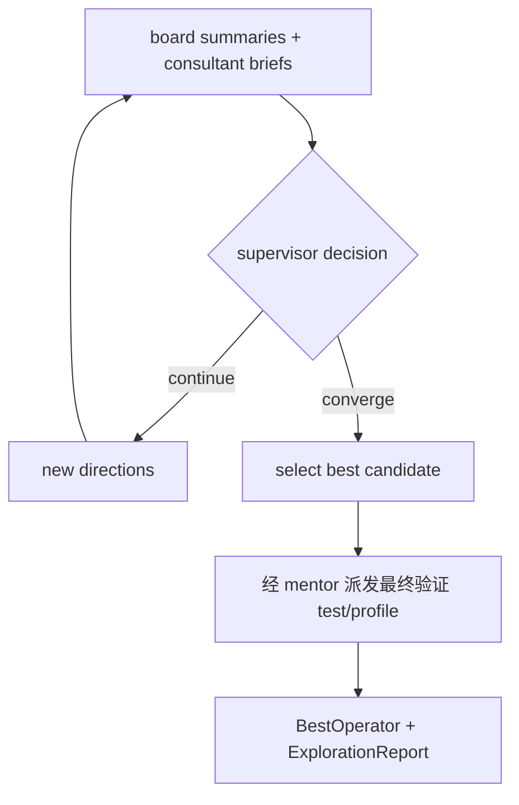

# 03 目标架构

> 上层：[02-system-context.md](02-system-context.md)  
> 下层：[04-domain-model.md](04-domain-model.md)

---

## 1. 架构原则

| 编号 | 原则 | 可检查规则 |
| --- | --- | --- |
| **P1** | 一个集群只优化一个算子 | Cluster 必须绑定唯一 Operator；不能跨算子共享 board。 |
| **P2** | 角色即权限 | 每个 Role 有固定能力矩阵；ACL 在消息/工具层强制。 |
| **P3** | 分层通信 | supervisor/consultant/mentor/worker 只能走定义好的 board/channel。 |
| **P4** | worker 隔离 | worker 不能访问任何 board；只能读写自己的私有 channel。 |
| **P5** | 不可变候选 | CandidateVersion 一旦提交不可修改；新版本用新 ID/parent。 |
| **P6** | 全程留痕 | 每个候选有源码快照与 TestRecord zip；最终报告可追溯。 |
| **P7** | 技能可插拔 | tester/profiler 行为由 Deep Agents `SKILL.md` 定义；核心不硬编码流程。 |
| **P8** | 多进程 | 控制面、Agent 运行时、工具/硬件服务分离；不假设单进程。 |
| **P9** | 至少一次 + 幂等 | 消息/任务/租约都有 ID 与幂等键；重复不产生重复副作用。 |
| **P10** | 领域无 I/O | 领域层不导入数据库、HTTP、模型、文件系统或进程库。 |

---

## 2. 目录结构

```text
JustKernel/
├── pyproject.toml                 # 只暴露 justkernel
├── src/justkernel/
│   ├── shared/                    # ID、Digest、Clock、错误、规范 JSON
│   ├── cluster/                   # Cluster、OperatorSpec、Direction、membership、convergence
│   ├── agent/                     # AgentInstance、Role、lifecycle、runtime port
│   ├── comm/                      # Board、Channel、Message、ACL、router
│   ├── task/                      # Task、TaskContext、assignment、worker lifecycle
│   ├── candidate/                 # CandidateVersion、版本图、best
│   ├── testing/                   # TestRecord、HardwareQueue、skill contract
│   ├── report/                    # ExplorationReport
│   ├── platform/                  # 适配器
│   │   ├── config.py
│   │   ├── persistence/           # SQLite、事件、投影、迁移
│   │   ├── artifacts/             # 内容寻址 zip/source
│   │   ├── runtime/               # Deep Agents runner、进程池、checkpoint、wake scheduler
│   │   ├── bus/                   # 本地消息总线/A2A
│   │   ├── tools/                 # 编译/测试/profile 后端
│   │   ├── hardware/              # 设备队列/租约
│   │   ├── models/                # 模型档案/provider
│   │   └── http/                  # API/SSE
│   ├── bootstrap/                 # 组合根、CLI、迁移、恢复
│   ├── resources/
│   │   ├── skills/                # 基础角色 + 内置 tester/profiler skills
│   │   └── templates/             # 算子工程/报告模板
│   └── web/                       # 前端
├── tests/
│   ├── unit/
│   ├── application/
│   ├── adapters/
│   ├── integration/
│   ├── architecture/
│   └── web/
└── docs/
```

包名统一为 `justkernel`；不创建 `aworker` 模块。旧 CLI 名如需过渡，只能做**外部脚本别名**，不能形成第二个包。

---

## 3. 模块与职责

| 模块 | 负责 | 不负责 |
| --- | --- | --- |
| `cluster` | 单算子集群、supervisor、成员、方向、收敛、best | Agent 内部循环、工具执行 |
| `agent` | 角色、AgentInstance、生命周期、skills、模型绑定 | 消息路由、board 存储 |
| `comm` | board/channel、消息类型、ACL、投递、幂等 | 领域任务规则 |
| `task` | mentor→worker 任务、状态、重派、取消 | 具体测试/优化实现 |
| `candidate` | 不可变候选版本、源码快照、版本图、best 规则 | 测试执行、报告排版 |
| `testing` | TestRecord、压缩包、硬件队列、skill 契约 | 模型调用、board |
| `report` | 探索报告、最终交付 | Agent 调度 |
| `platform` | 持久化、运行时、总线、工具、硬件、模型、HTTP | 领域决策 |
| `bootstrap` | 装配、迁移、恢复、CLI | 业务规则 |

### 3.1 依赖方向

```text
shared ← domain (cluster/agent/comm/task/candidate/testing/report)
                      ↑
                 application
                      ↑
              orchestration
                      ↑
        http/a2a/cli ← bootstrap → adapters
```

规则：

1. `*/domain.py` 只依赖 `shared` 与同模块值对象。
2. 应用服务依赖端口，不依赖 adapter。
3. `comm` 是消息/ACL 的唯一入口；其他模块不得直接写 board/channel。
4. `agent` 不直接写候选/测试记录；通过工具 → 应用用例。
5. `platform` 实现端口，不反向依赖 `bootstrap`/`http`。
6. 任何模块导入时不得建目录、连库、启动任务、读环境变量（`platform/config.py` 除外）。

---

## 4. 多进程运行时

### 4.1 进程角色

| 进程/服务 | 职责 | 是否跑模型 |
| --- | --- | --- |
| **Control Service** | API/SSE/A2A、角色注册、消息路由、任务调度、board、收敛、持久化 | 否 |
| **Agent Runtime Pool** | 执行 Deep Agents 会话；按角色加载 tools/skills；输出公开事件 | 是 |
| **Tool & Hardware Service** | 编译、测试、profile、设备队列、租约 | 否 |
| **Storage** | SQLite/事件/制品库（可嵌入 Control） | 否 |
| **Web** | 静态前端/回放 | 否 |

### 4.2 协议

**Control ↔ Runtime**

```text
CreateAgent(role, model, skills, mentor_id?) -> AgentId
StartTurn(agent_id, input) -> TurnId
SendMessage(agent_id, message) -> Ack
CloseAgent(agent_id) -> Ack
CancelTurn(turn_id) -> Ack
Events: AgentStatus, Message, ToolEvent, TurnCompleted/Failed
```

**Control ↔ Tool/Hardware**

```text
SubmitTest(task_id, candidate_id, skill_ref, case_selection, timeout_s, device?) -> ToolJobRef
SubmitProfile(task_id, candidate_id, skill_ref, case_selection, timeout_s, device?) -> ToolJobRef
ReadToolJob(job_id) -> ToolJobView
QueueStatus(device?) -> QueueView
AcquireLease(cluster_id, task_id, job_id, device, purpose) -> LeaseId
ReleaseLease(lease_id) -> Ack
```

**Control ↔ Storage**

- 仓储/事件/制品端口；事务在 Control 内完成。
- Tool Service 写制品并向 Control 回报结果；TestRecord 索引、Task/job 终态、事件及唤醒由 Control 事务封存，不由工具进程直接写领域数据库。
- 全局 registry.db 管活动集群注册；全局 hardware.db 管跨集群租约；各 journal.db 中仅保存引用/投影，见 08 章。

### 4.3 为什么多进程

- Agent 崩溃不拖垮控制面。
- 100 个逻辑 agent 可共享进程池，避免 100 个 OS 进程。
- 工具/硬件服务可独立部署、限流、隔离设备。
- 消息/任务边界明确，便于恢复与观测。

**不是微服务**：默认单机多进程；模块边界与协议是核心，部署可合并。

---

## 5. 核心数据流

### 5.1 方向与探索



### 5.2 候选与测试



### 5.3 收敛与交付



---

## 6. 架构决策（ADR）

| ID | 决策 | 理由 | 代价 |
| --- | --- | --- | --- |
| D1 | 单算子、单 supervisor | 目标明确、责任唯一 | 跨算子需新集群 |
| D2 | 固定角色层级 | 分工/权限清晰 | 角色之间不能随意越级 |
| D3 | board + 私有 channel | 共享探索但隔离 worker | 需要 ACL/路由 |
| D4 | consultant 只读 mentor board | 汇总不干预 | consultant 信息有延迟 |
| D5 | worker 完全不能读 board | 防止污染/越权 | worker 只依赖 mentor 上下文 |
| D6 | 逻辑 agent + 进程池 | 100 agent 可运行 | runtime 需会话隔离 |
| D7 | 候选不可变 + 版本图 | 可追溯、可比较 | 存储增长 |
| D8 | 每候选 TestRecord zip | 审计/复现 | 需归档策略 |
| D9 | tester/profiler 用 skills 定义 | 用户可扩展 | 需稳定工具契约 |
| D10 | 硬件队列集中租约 | 避免并发冲突 | 工具服务成为依赖 |
| D11 | 多进程控制/执行分离 | 稳定性/扩缩 | 需 RPC/幂等/恢复 |
| D12 | 包名 justkernel，删除 aworker 模块 | 消除双栈 | 迁移/别名 |
| D13 | 旧 lab 数据只读迁移 | 保留历史 | 旧数据不参与新集群 |
| D14 | 消息至少一次 + 幂等 | 崩溃恢复 | 消费者必须去重 |

---

## 7. 模块规模预算

| 类型 | 上限 |
| --- | --- |
| 领域文件 | 300 行 |
| 应用服务 | 400 行 |
| Adapter | 600 行 |
| 前端模块 | 400 行 |
| 单函数 | 40 行 |

---

## 8. 完成定义

- [ ] 单算子集群可启动/停止，supervisor 唯一。
- [ ] 角色 ACL 在消息和工具层同时生效。
- [ ] worker 无 board 访问；mentor 可开关 worker。
- [ ] tester/profiler 通过 skills 加载，首版 CANN 仿真可用。
- [ ] 每候选生成 TestRecord zip；最优选择可追溯。
- [ ] 多进程运行时崩溃可恢复；无孤儿 agent/租约。
- [ ] 旧 lab 数据只读导入；`aworker` 模块删除。

## 9. 新增执行边界

- 生成链：OperatorSpec → GENERATE/IMPORT → 候选 → 完整 TEST → baseline → OPTIMIZE；不要求启动前已有源码。
- 编排链：领域事件 → outbox → inbox/wake → 单 Agent 串行 Turn → 结构化下一步；模型输出只能提出动作，由应用层校验执行。
- 反馈链：mentor 选取证据 → TaskContext 不可变制品及授权 → 新 worker；禁止为续接上下文而放开 board ACL。
- 源码实体与测量读模型、BestSelection 分离；最终选择只引用完整有效证据。
- 跨库操作采用幂等命令及补偿，不假设 registry/journal/hardware/文件系统可共享一个事务。具体契约见 [13 章](13-generation-and-iteration-contract.md)。
