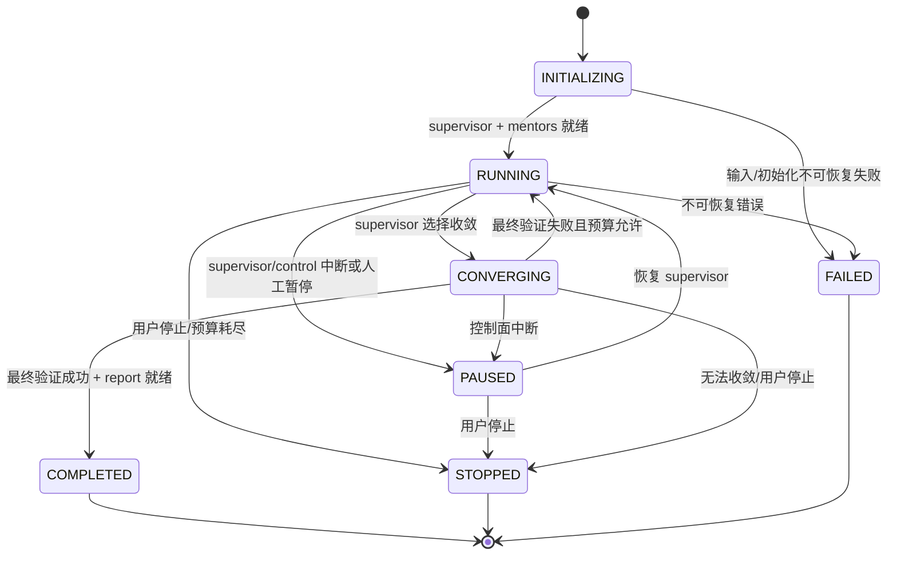
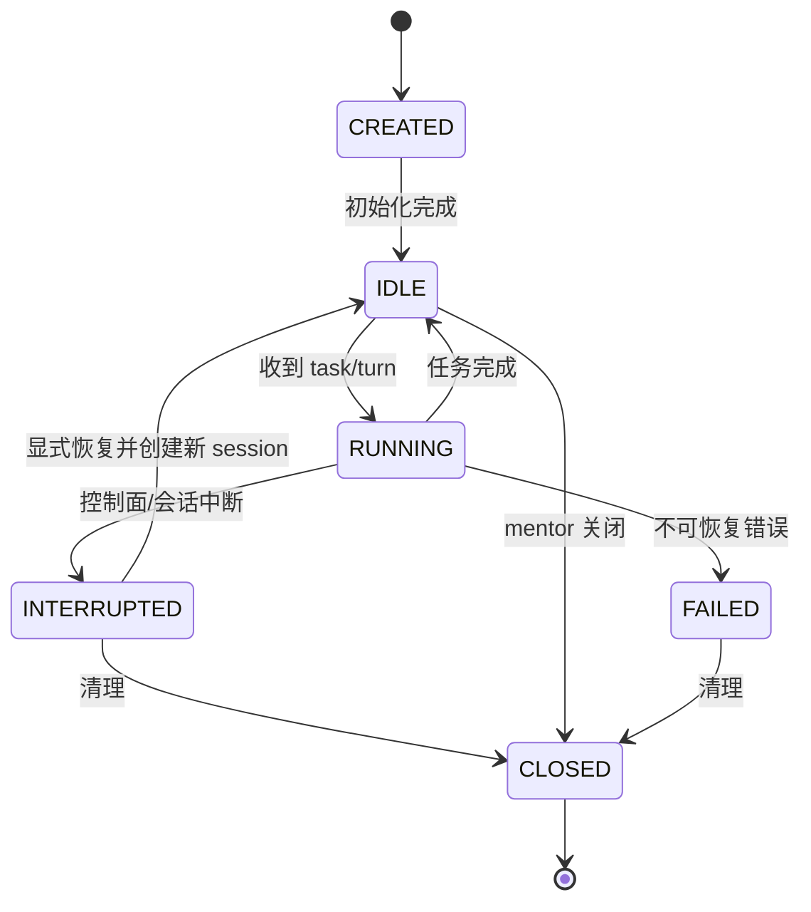
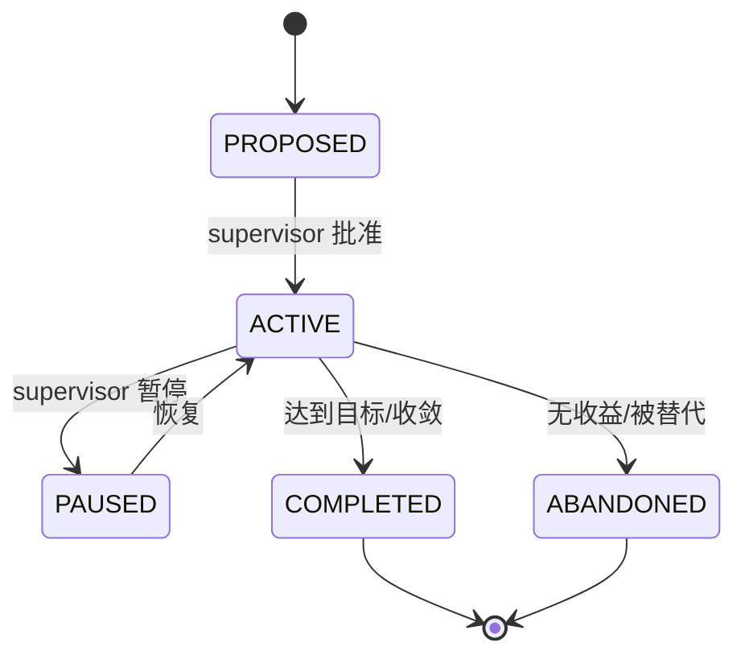
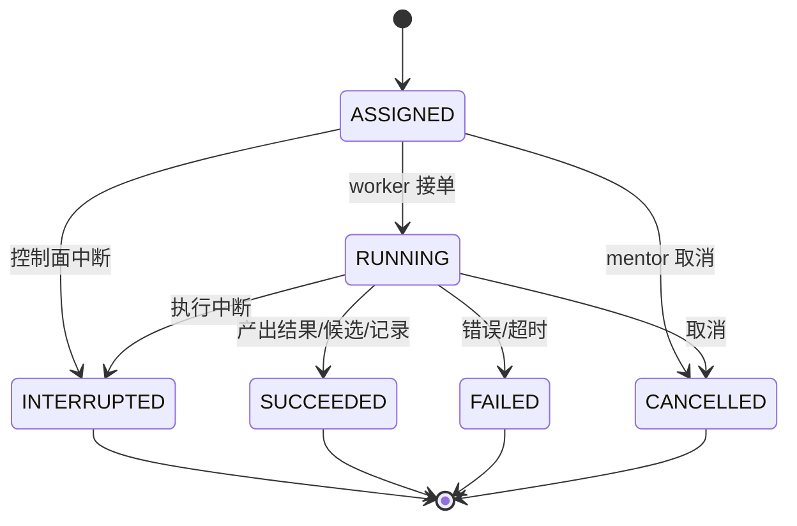
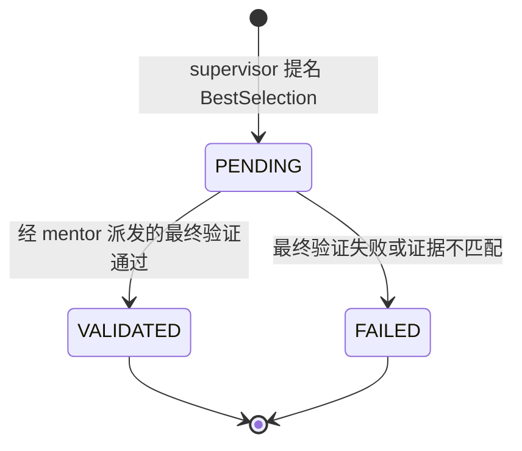

# 04 领域模型

> 上层：[03-architecture.md](03-architecture.md)  
> 下层：[05-agent-runtime-and-skills.md](05-agent-runtime-and-skills.md)

---

## 1. 统一语言

| 术语 | 定义 |
| --- | --- |
| **Cluster** | 一个算子优化集群；绑定一个 Operator，一个 supervisor。 |
| **Agent** | 一个 Deep Agents 实例；有 Role、模型、skills、会话、检查点。 |
| **Role** | `SUPERVISOR` / `CONSULTANT` / `MENTOR` / `OPTIMIZER` / `TESTER` / `PROFILER`。 |
| **Direction** | supervisor 分配给某个 mentor 的探索方向。 |
| **MentorBoard** | supervisor 与 mentors 共享的探索黑板。 |
| **ConsultantBoard** | consultants 与 supervisor 共享的汇总区。 |
| **WorkerChannel** | 一个 mentor 与其一个 worker 的私有通道。 |
| **Task** | mentor 下发给直属 worker 的一次工作。 |
| **Candidate** | 一个不可变算子源码版本（CandidateVersion）。 |
| **TestRecord** | 与候选绑定的测试/ profile 记录压缩包及索引。 |
| **HardwareLease** | tester/profiler 对设备/仿真资源的独占租约。 |
| **ExplorationReport** | 集群结束时的探索报告。 |
| **BestOperator** | supervisor 选择、经过最终验证的最优候选。 |

禁止混用：`team`、`work item`、`official judge`、`candidate queue` 作为核心领域概念；它们属于旧 lab 或可选验收。

---

## 2. 角色与通信 ACL

### 2.1 角色职责

| Role | 职责 | 不能做 |
| --- | --- | --- |
| **SUPERVISOR** | 定方向、决定收敛/停止、选择 best、读 board/brief | 直接改代码、直接指挥 worker、读取 worker 私有 channel |
| **CONSULTANT** | 只读 mentor board，汇总给 supervisor；consultants 之间共享 | 指挥 mentor/worker、写 mentor board |
| **MENTOR** | 在 direction 内探索、开/关 worker、下发 task、汇总到 board | 越界读别人的 worker channel、直接改代码 |
| **OPTIMIZER** | 根据 GENERATE 从零生成工程或 OPTIMIZE 修改代码、提交候选 | 读 board、测试/profile、给其他 worker 下任务 |
| **TESTER** | 按 skill 执行测试、产出 TestRecord | 读 board、改代码、profile |
| **PROFILER** | 按 skill 执行 profile、产出 TestRecord | 读 board、改代码、测试 |

### 2.2 ACL 表

| 资源 | 读 | 写 |
| --- | --- | --- |
| **MentorBoard** | supervisor, mentors, consultants | supervisor, mentors |
| **ConsultantBoard** | supervisor, consultants | supervisor, consultants |
| **WorkerChannel(mentor, worker)** | 对应 mentor + worker | 对应 mentor + worker |
| **HardwareQueue** | testers, profilers；supervisor/mentors 只读队列摘要 | tester/profiler 通过受控提交接口申请；仅 tool service 写权威租约 |
| **Candidate source** | 作者/所属 mentor、supervisor；已发布候选供同集群 mentors 只读；worker 限任务授权 | optimizer 编辑 workspace，Control 固化不可变候选；mentor 发布引用 |
| **TestRecord** | 关联 mentor/supervisor、tester/profiler 作者；已发布证据供同集群 mentors 只读 | 只追加，不修改；optimizer 仅读授权反馈快照 |
| **ExplorationReport** | supervisor、用户 | supervisor + report service |

**硬规则**：

- worker 不能读/写任何 board。
- consultant 只能读 MentorBoard，不能写；只能写 ConsultantBoard 和给 supervisor 的 brief。
- mentor 只能给自己的 worker 下发 task；不能给其他 mentor 的 worker 下发。
- tester/profiler 只能通过 HardwareQueue 共享排队信息，不能借此读取 board。
- human/UI 可以查看全部（受审计），但不是 agent 权限。

---

## 3. 值对象

| 类型 | 规则 |
| --- | --- |
| `ClusterId` / `AgentId` / `DirectionId` / `TaskId` / `CandidateId` / `TestRecordId` / `MessageId` / `LeaseId` | 32 位小写十六进制（UUID4） |
| `Role` | 固定枚举，见上 |
| `SourceRevision` | `files: Map[ProjectPath, str]`, `digest`（v2 规范哈希） |
| `ProjectPath` | 相对 POSIX 路径，禁止绝对路径/`..`/反斜杠/NUL |
| `SkillRef` | `{name, version, source_path, digest}` |
| `SkillSource` | `/skills/base/`、`/skills/user/tester/`、`/skills/user/profiler/` 等 |
| `Metric` | `{name, value, unit, direction}`；已知 value 为有限数，缺失为 null，不补 0 |
| `TestOutcome` | `PASS` / `FAIL` / `ERROR` / `CANCELLED` / `UNKNOWN` |
| `DeviceId` | 设备/仿真器标识 |
| `Digest` | 64 位小写十六进制 |
| `Principal` | `agent:<AgentId>` / `human` / `system` |

---

## 4. 聚合

### 4.1 Cluster

| 字段 | 说明 |
| --- | --- |
| `id` | ClusterId |
| `operator_id` | 唯一算子 |
| `supervisor_id` | 唯一 supervisor |
| `operator_spec_ref` / `start_mode` | 第 13 章固定输入契约；GENERATE 或 IMPORT |
| `phase` / `baseline_candidate_id` | BOOTSTRAPPING/OPTIMIZING/FINALIZING；验证前基线为空 |
| `continued_from_cluster_id` | 新一轮研究的来源集群，可空 |
| `state` | 见状态机 |
| `max_agents` | 默认 100 |
| `best_candidate_id` | 最优候选 |
| `report_id` | 探索报告 |
| `created_at` / `closed_at` | |

**不变量**：

- 一个 Cluster 恰好一个 supervisor 和一个 operator。
- 活动 agent 总数 ≤ `max_agents`。
- 没有 supervisor 不能进入 `RUNNING`。
- `COMPLETED` 必须有 best candidate + report；`STOPPED` 可以没有 best。
- `best_candidate_id` 必须引用一个已最终验证的 VALIDATED BestSelection；无性能目标不要求 PROFILE，有性能目标必须有可比 PROFILE。

**命令**：`StartCluster`, `SetMaxAgents`, `Converge`, `StopCluster`。
**事件**：`ClusterStarted`, `ClusterConverging`, `ClusterCompleted`, `ClusterStopped`。

### 4.2 AgentInstance

| 字段 | 说明 |
| --- | --- |
| `id` | AgentId |
| `cluster_id` | |
| `role` | Role |
| `mentor_id` | worker 必填；其他角色为空 |
| `model_profile` | |
| `skills` | `SkillRef[]` |
| `state` | 见状态机 |
| `session_id` / `checkpoint_ref` | |
| `created_at` / `closed_at` | |

**不变量**：

- supervisor 唯一；consultant/mentor/worker 可多个。
- worker 必须且只能有一个 mentor。
- worker 的 `mentor_id` 必须是一个 mentor 的 AgentId。
- worker 不能是其他 worker 的 mentor。
- 关闭后不能接收新 task；已有结果保留。
- 一个 agent 同一时刻最多一个 RUNNING task/turn。
- 总活动 agent ≤ max_agents。

**命令**：`CreateAgent`, `CloseAgent`, `AssignTask`, `CompleteTask`。
**事件**：`AgentCreated`, `AgentIdle`, `AgentRunning`, `AgentInterrupted`, `AgentFailed`, `AgentClosed`。

说明：worker 通常 `RUNNING → IDLE → CLOSED`；mentor 可保留 idle worker 以便复用，但应在任务结束后关闭。

### 4.3 Direction

| 字段 | 说明 |
| --- | --- |
| `id` | DirectionId |
| `cluster_id` | |
| `mentor_id` | 负责的 mentor |
| `objective` | 大方向/假设 |
| `constraints` | 约束/预算 |
| `state` | 见状态机 |
| `summary` | mentor 的阶段性汇总 |
| `created_at` / `closed_at` | |

**不变量**：

- 一个 mentor 同一时刻最多一个 ACTIVE direction。
- direction 只能由 supervisor 创建/关闭；mentor 可以提议新方向，但不能自行切换。
- direction 不共享给其他 mentor 作为任务；其他 mentor 只能通过 board 学习数据。
- 完成/放弃必须记录原因。

### 4.4 Task

| 字段 | 说明 |
| --- | --- |
| `id` | TaskId |
| `cluster_id` | |
| `mentor_id` | 下发者 |
| `worker_id` | 执行者（直属） |
| `kind` | `GENERATE` / `OPTIMIZE` / `TEST` / `PROFILE` |
| `candidate_id` | GENERATE 必须为空；其他任务必须引用已有候选 |
| `operator_spec_ref` / `direction_id` | 固定语义契约与本任务所属方向 |
| `context_ref` / `context_digest` | 不可变 TaskContext 及只读授权，见 13 章 |
| `retry_of_task_id` / `budget_ref` | 新任务重派来源、预算引用 |
| `skill_ref` | tester/profiler 必填 |
| `objective` / `constraints` | |
| `state` | 见状态机 |
| `result_ref` | WorkerResult / TestRecord |
| `created_at` / `finished_at` | |

**不变量**：

- task 的 `mentor_id` 必须是 `worker_id` 的 mentor。
- worker 只能同时执行一个 task。
- `TEST`/`PROFILE` 必须有 `skill_ref` 和 `candidate_id`。
- `GENERATE`/`OPTIMIZE` 产出新 CandidateVersion；GENERATE 从 OperatorSpec 建工程，OPTIMIZE 必须有 base。
- 关闭的 worker 不能接新 task。
- task 失败/取消必须记录原因；可重派但新 TaskId。

### 4.5 CandidateVersion

| 字段 | 说明 |
| --- | --- |
| `id` | CandidateId |
| `cluster_id` | |
| `parent_id` | GENERATE/IMPORT 根候选为 null；修复/优化指向输入候选，基线可能为修复后的后代 |
| `author_agent_id` | optimizer；IMPORT 时为空且 author_principal=system |
| `author_principal` / `task_id` / `import_id` | 生成/优化任务或系统导入来源；必须恰有一种来源 |
| `direction_id` | 所属探索方向 |
| `source` | SourceRevision 不可变快照 |
| `diff_artifact` | 与 parent 的 diff |
| `evaluation` | CandidateEvaluationView 引用；不属于源码实体可变状态 |
| `metrics` | 按契约/环境/skill 分组的测量读模型，不覆盖原始记录 |
| `created_at` | |

**不变量**：

- 候选源码不可变；修改必须新 CandidateId。
- `parent_id` 必须属于同一 cluster；不能成环。
- 每个提交候选安排 TEST；测试前允许 UNTESTED，收敛前必须有真实执行或明确未执行的审计记录。
- best 是独立 BestSelection，经最终完整 TEST 验证；有性能目标必须 PROFILE。
- 候选必须记录 author/direction/任务来源。

候选提交后仅为不可变快照；草稿属于 workspace。测试可重复，完整正确性视图为 `UNTESTED | TESTING | PASS | FAIL | ERROR | CANCELLED | UNKNOWN`，PROFILE 记录单列，不作为进入 best 的通用必经状态。

BestSelection 字段：id、cluster_id、candidate_id、policy_digest、nomination_record_ids、final_task_ids、final_record_ids、state、reason、created_at。只有 VALIDATED 才更新 cluster.best_candidate_id；重新提名用新 selection。

### 4.6 TestRecord

| 字段 | 说明 |
| --- | --- |
| `id` | TestRecordId |
| `candidate_id` | |
| `task_id` | 实际任务；未执行系统审计允许为空，改用 audit_id 去重 |
| `job_id` / `audit_id` / `executed` / `coverage` | 真实作业或系统审计来源，见 13 章 |
| `kind` | `TEST` / `PROFILE` |
| `skill_ref` | 使用的用户/内置 skill |
| `backend` | `cann-simulation` / `npu` / 自定义 |
| `outcome` | TestOutcome |
| `artifact` | zip 的 ArtifactRef + sha256 |
| `summary` | 粗结果指标 |
| `environment` | 设备/CANN/Python/工具版本 |
| `created_at` | |

**不变量**：

- 实际执行记录与候选/任务/skill 版本绑定；未执行系统审计绑定候选/audit_id/计划 skill，标明 executed=false；所有记录不可修改。
- zip 必须包含 07 规定的必需文件；哈希校验。
- 同一 task 最多一个终态记录；重复写入幂等。
- 完整执行 PASS 才能认定基线或参与最终最优验证；未执行/子集记录只提供相应范围证据。

### 4.7 HardwareLease

| 字段 | 说明 |
| --- | --- |
| `id` | LeaseId |
| `device_id` | |
| `task_id` | tester/profiler task |
| `owner_agent_id` | |
| `state` | `QUEUED` / `LEASED` / `RELEASED` / `EXPIRED` |
| `acquired_at` / `expires_at` | |

**不变量**：

- 同一 `device_id` 同时最多一个 `LEASED`。
- 只有 tester/profiler/tool service 可以申请/释放。
- worker 关闭/崩溃后由工具服务核对实际执行，确认停止后清理租约；未知则隔离设备，不能按角色死亡直接解锁。
- 队列状态对 tester/profiler 可见，但不含 board 数据。

### 4.8 ExplorationReport

| 字段 | 说明 |
| --- | --- |
| `id` | |
| `cluster_id` | |
| `best_candidate_id` | STOPPED/FAILED 报告可空；COMPLETED 必填 |
| `revision` | 同一集群报告版本，追加而不覆盖 |
| `directions` | 方向/分支/hypothesis |
| `candidates` | 版本图与指标 |
| `records` | TestRecord 索引/哈希 |
| `failures` | 失败路径/被否方案 |
| `decision` | 最优选择理由 |
| `created_at` | |

**不变量**：

- 报告只引用已存在的候选/记录。
- 报告必须包含失败路径，不只写成功。
- 最终报告不可修改；新结论用新报告版本。

---

## 5. 跨聚合不变量

| 编号 | 不变量 |
| --- | --- |
| I1 | 一个 Cluster 恰好一个 supervisor、一个 operator。 |
| I2 | 一个 worker 恰好一个 mentor；worker 不能有下级。 |
| I3 | 活动 agent 总数 ≤ max_agents；worker 只能由 mentor 创建/关闭。 |
| I4 | worker 无任何 board ACL；consultant 对 MentorBoard 只读。 |
| I5 | Task 只能由 worker 的 mentor 下发；worker 同时最多一个 task。 |
| I6 | Candidate 不可变；parent 图无环。 |
| I7 | 每个提交候选安排 TEST，收敛前归档执行/未执行记录；baseline/best 必须完整执行 PASS，best 还须最终验证。 |
| I8 | 所有候选的 TestRecord 保留；最终报告引用它们。 |
| I9 | 同一设备跨所有集群最多一个有效执行租约；全局设备服务仲裁。 |
| I10 | 消息至少一次投递；重复消息按 MessageId 幂等。 |
| I11 | 领域状态只写 SQLite/制品库；无可变 JSON 领域状态。 |
| I12 | 模型/board 内容是数据，不能改变 ACL/状态机规则。 |

---

## 6. 消息类型

| 类型 | 方向 | 通道 | 要点 |
| --- | --- | --- | --- |
| `DirectionAssigned` | supervisor → mentor | MentorBoard | 目标/约束/预算 |
| `MentorSummary` | mentor → board | MentorBoard | 假设/候选/结果/下一步 |
| `MentorDataShared` | mentor → mentors | MentorBoard | 可复用发现/失败路径 |
| `ConsultantBrief` | consultant → supervisor | ConsultantBoard | 汇总/冲突/建议 |
| `TaskAssigned` | mentor → worker | WorkerChannel | kind/candidate/skill/constraints/context_ref/context_digest |
| `WorkerResult` | worker → mentor | WorkerChannel | 状态/指标/记录/错误 |
| `CandidateCommitted` | optimizer → mentor | WorkerChannel | 新候选版本 |
| `TestRecordCreated` | tester/profiler → mentor | WorkerChannel | zip/摘要/outcome |
| `HardwareQueueEvent` | tool service → tester/profiler | HardwareQueue | 排队/租约/释放 |
| `Decision` | supervisor → mentors | MentorBoard | continue/pivot/converge/stop |
| `AgentLifecycle` | mentor/tool service | Control | open/close/failed |

消息负载只包含 DTO；不序列化 ORM 行、异常、密钥、绝对私有路径。

## 7. 新增执行实体

- `OperatorSpec`、`TaskContext`、`ToolJob`、`WakeRequest`、`BudgetPolicy`、`EvaluationPolicy` 的统一字段和约束见 [13 章](13-generation-and-iteration-contract.md)。
- Task SUCCEEDED 表示任务产物已交付，不代表候选正确；TEST/PROFILE 的 PASS/FAIL/ERROR 由 TestRecord.outcome 决定。
- `HardwareLease` 的 Task/Agent 关联在跨集群设备账本中用 `(cluster_id, id)` 引用；集群本地镜像不能授予设备执行权。
- `Direction` 的“最多一个 ACTIVE”实现约束统一为最多一个未关闭方向（PROPOSED/ACTIVE/PAUSED），避免暂停期间并发分配第二方向。
