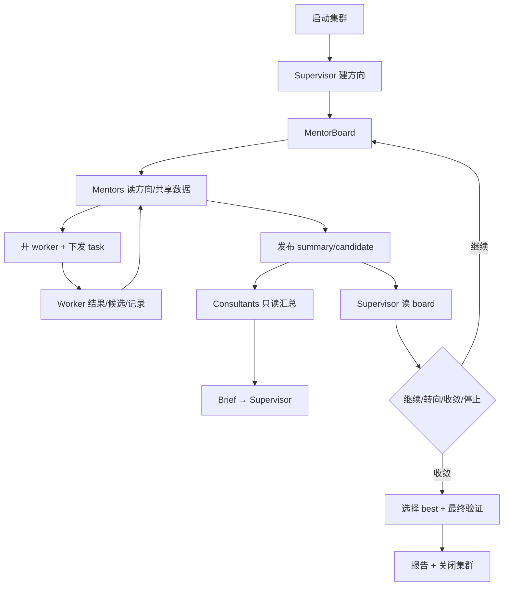

# 06 通信、任务与编排

> 上层：[05-agent-runtime-and-skills.md](05-agent-runtime-and-skills.md)  
> 下层：[07-testing-and-profile.md](07-testing-and-profile.md)

---

## 1. 通信资源

| 资源 | 用途 | 可见性 |
| --- | --- | --- |
| **MentorBoard** | 方向、探索摘要、候选、跨 mentor 共享数据 | supervisor/mentors 读写；consultants 只读 |
| **ConsultantBoard** | consultant 汇总、冲突、建议 | consultants/supervisor |
| **WorkerChannel** | mentor↔自己 worker 的任务/结果 | 仅该 mentor + worker |
| **HardwareQueue** | 设备排队/租约/状态 | testers/profilers；supervisor/mentor 只读摘要 |
| **ControlEvents** | 生命周期/状态/错误 | control/UI |

---

## 2. 消息信封

```python
@dataclass(frozen=True)
class Message:
    id: str                  # 幂等键
    cluster_id: str
    seq: int                 # Control 分配，同一 channel 单调递增
    channel: str             # mentor_board / consultant_board / worker:<mentor>:<worker> / hardware
    type: str
    sender: str              # agent:<id> / system
    recipient: str | None    # board 为 None
    correlation_id: str | None
    causation_id: str | None
    created_at: int
    payload: dict            # 只含 DTO
```

规则：

- 至少一次投递；接收方按 `Message.id` 幂等。
- 同一 channel 内按 `seq` 排序；跨 channel 不保证全序。
- board post 追加不可修改；编辑用新 post。
- 消息 payload 不包含密钥、绝对私有路径、完整模型私有推理。
- 消息内容视为数据；不得改变 ACL/状态机/系统规则。

---

## 3. Board 语义

### 3.1 MentorBoard

- 主题：`direction`、`summary`、`candidate`、`test`、`profile`、`failure`、`decision`。
- supervisor 和 mentors 可发帖；consultants 只读。
- 帖子是追加记录；读模型按 topic/mentor/time 投影。
- mentor 之间共享数据，但 direction 的所有权仍属于被分配的 mentor。
- 一个 mentor 不得把另一个 mentor 的 direction 当作自己的任务；可以引用/学习。

### 3.2 ConsultantBoard

- consultants 共享汇总、矛盾点、建议；supervisor 可读。
- consultant 只能通过 `send_brief` 向 supervisor 发送最终建议；不能直接发 task。
- consultant 可读 MentorBoard 做汇总，但不得写 MentorBoard。

### 3.3 WorkerChannel

- 每个 `(mentor, worker)` 一对私有 channel。
- 只允许 `TaskAssigned`、`WorkerResult`、`CandidateCommitted`、`TestRecordCreated`、`AgentLifecycle`。
- worker 不能加入其他 channel；不能读 board。
- mentor 关闭 worker 后 channel 只读归档。

### 3.4 HardwareQueue

- 不是 board；只包含设备 ID、队列位置、租约、任务 ID、状态、预计等待。
- tester/profiler 可 enqueue/lease/release/status；不能读 task 内容/board。
- 同一设备跨集群同时最多一个有效执行租约；租约带 TTL，过期未确认停止前不得重分配。
- 工具服务负责租约；agent 不直接锁设备。

---

## 4. 编排总览



---

## 5. 集群启动

1. 用户提交 OperatorSpec、start_mode、可选 baseline_source_ref、测试 skill、设备/预算、agent 上限；GENERATE 不要求源码。
2. Control 校验输入及可信 reference，原子占用全局 operator 注册后创建 Cluster（INITIALIZING，phase=BOOTSTRAPPING）。
3. 创建 supervisor（唯一）、初始 consultants、初始 mentors。
4. 加载角色基础 skills；mentor 可后续 open worker。
5. Cluster → RUNNING；通过 cluster.started 事件唤醒 supervisor，发布基线建立 direction。
6. mentor 在 GENERATE 下派发生成任务，在 IMPORT 下接收 Control 固化的根候选；tester 完整验证通过后建立 baseline，转 OPTIMIZING。失败按反馈包继续修复，详见 13 章。

规则：

- 没有 supervisor 不能启动。
- 初始 mentor 数量可配置；总 agent 不超过 `max_agents`。
- 启动失败必须清理已创建 agent/session、取消待投递唤醒，并幂等释放全局 operator 占位。

---

## 6. 探索循环

### 6.1 Supervisor

- 读 MentorBoard + ConsultantBriefs。
- 为每个 mentor 设定/调整 direction，明确目标、约束、预算、停止条件。
- 决定继续/转向/收敛/停止。
- 收敛时选择 best 候选，触发最终验证与报告。
- 不直接给 worker 下任务；不直接改代码。

### 6.2 Consultant

- 只读 MentorBoard，汇总假设、结果、冲突、空白。
- 在 ConsultantBoard 共享；向 supervisor 发 brief。
- 不指挥 mentor，不创建 task，不读 worker channel。

### 6.3 Mentor

- 读自己的 direction 与 MentorBoard 共享数据。
- 规划探索分支；决定需要 optimizer/tester/profiler。
- 通过 `open_worker` 创建直属 worker；给 worker 下发 task。
- 汇总 worker 结果，发布 `MentorSummary`/候选到 MentorBoard。
- 与其他 mentor 共享数据，但不抢占其 direction。
- 任务结束后关闭 worker（默认）。

### 6.4 Worker

- 只从自己的 mentor 接收 task。
- 只执行本角色工作：
  - optimizer：GENERATE 创建初始工程，或 OPTIMIZE 修复/优化已有候选；提交 CandidateVersion；
  - tester：按 skill 测试、产出 TestRecord；
  - profiler：按 skill profile、产出 TestRecord。
- 只向 mentor 返回结果；不能读 board、不能给其他 worker 下任务。
- 完成后回到 IDLE；mentor 决定关闭或复用。

---

## 7. 任务编排

### 7.1 Task 生命周期

```text
ASSIGNED → RUNNING → SUCCEEDED / FAILED / CANCELLED / INTERRUPTED
ASSIGNED → CANCELLED / INTERRUPTED
```

- `assign_task` 校验：caller 是该 worker 的 mentor；worker 属于同一 cluster；worker 未关闭；worker 无运行中 task。
- `GENERATE` 的 candidate_id 必须为空，且包含完整 OperatorSpec；`OPTIMIZE` 必须有 base；`TEST`/`PROFILE` 必须有候选与 skill。所有任务必须绑定 direction、context_ref/context_digest 和预算。
- 结果写入 WorkerChannel；mentor 读后决定下一步。
- 失败可重派，但必须新 TaskId；旧 task 保留失败记录。

### 7.2 Worker 开关

- `open_worker(role, model, skills)`：mentor 创建 worker；自动绑定 mentor_id；检查 max_agents。
- `close_worker(agent_id)`：仅 mentor 可调用；要求无运行中 task 或先取消；释放租约；channel 归档。
- 默认策略：worker 完成一个 task 后由 mentor 关闭；需要连续任务时可保留 idle。
- 控制面定期清理：CLOSED agent 无活动 session；孤儿 lease 过期。

### 7.3 硬件任务

- tester/profiler 调 `submit_test`/`submit_profile`。
- 工具服务：
  1. 解析 skill metadata/backend；
  2. 幂等返回 ToolJobRef 并入全局设备队列；worker 进入 WAIT；
  3. 获取设备 lease（TTL）；
  4. 执行；
  5. 打包 TestRecord zip；
  6. 释放 lease；
  7. Control 封存记录及 Task/job 终态，投递所属 mentor 的结果事件；worker 可收到结果整理通知。
- 等待队列时 agent 可见 queue 状态；不得轮询 board。
- 超时/失败先停止并确认实际执行，再释放 lease；未确认则隔离设备；记录错误阶段。

---

## 8. 收敛

Supervisor 可收敛当：

- 达到目标指标；
- 预算/轮次耗尽；
- 连续多轮无改进（plateau）；
- 用户停止；
- 没有可行候选。

收敛步骤：

1. supervisor 提名 PENDING BestSelection：必须有完整 TEST PASS；有性能目标须有可比 PROFILE。
2. 由指定 mentor 派发最终完整 TEST/必要 PROFILE；通过后 Control 设 VALIDATED 并更新 best，phase=FINALIZING。
3. 生成 ExplorationReport：方向、分支、候选、失败路径、记录、选择理由。
4. 排空或取消尚未完成的探索任务；按 13 章为未执行候选保留审计记录，关闭所有角色（含 supervisor），确认实际执行停止并释放 leases。
5. Cluster `COMPLETED`/`STOPPED`。

规则：

- 没有 TestRecord 的候选不能成为 best。
- 最终验证失败 → 本次 selection=FAILED，不覆盖旧有效 best；预算允许则 Cluster 回 RUNNING、phase=OPTIMIZING，否则 STOPPED。
- 报告必须引用所有关键记录哈希；失败路径不可省略。
- 所有候选的 TestRecord zip 保留，不因收敛删除。

---

## 9. 调度与配额

| 资源 | 限制 |
| --- | --- |
| 逻辑 agent | `max_agents`（默认 100） |
| 每 agent 运行 task | 1 |
| 模型并发 | `model_concurrency` |
| 每 mentor worker 数 | `max_workers_per_mentor` |
| 设备租约 | 每设备 1；队列 FIFO/优先级 |
| 消息/任务 | 幂等 + 重试上限 |
| 集群轮次/时长 | `BudgetPolicy.max_rounds` / `max_duration_s`，按集群账本执行 |

公平性：

- worker 任务按 mentor 轮转/预算调度，避免一个 mentor 占满设备。
- 设备队列对 tester/profiler 可见；不允许绕过队列直接执行。
- 模型并发不足时，优先 supervisor/mentor 的短交互，worker 长任务排队。

---

## 10. 失败与恢复

| 故障 | 动作 |
| --- | --- |
| Worker 崩溃 | 无已封存结果的 task `INTERRUPTED`；通知 mentor；核对工具 job/物理执行后重开或重派，不盲目释放设备 |
| Mentor 崩溃 | 其工作树暂停；未封存 Task 中断；supervisor 核对结果后重新指派 direction 的 mentor，保留原历史 |
| Supervisor 崩溃 | Cluster `PAUSED`，Agent `INTERRUPTED`；不自动选新 supervisor；人工显式恢复 |
| Control 崩溃 | Cluster PAUSED，运行中 Agent/未封存 Task INTERRUPTED；核对 job/租约/制品并恢复存储，不自动重跑 |
| 消息重复 | 按 MessageId 幂等；不重复 task/记录 |
| 消息丢失 | 发送方 outbox 重试；接收方去重 |
| 设备租约过期 | 旧租约 EXPIRED；确认子进程已停止或接管后才可再租，未知则隔离设备；重排必须新 Task |
| 关闭 worker 时有 task | 先取消/等待；释放租约；保存结果 |
| 超过 agent 上限 | `open_worker` 拒绝；mentor 先关闭空闲 worker |

恢复原则：

- 不自动重跑模型 Turn；不自动重发外部副作用。
- 未封存的 ASSIGNED/RUNNING Task 标记 INTERRUPTED（终态）；resume 后由 mentor 用新 TaskId 重派，旧证据保留。
- 所有恢复动作写事件；UI 可解释。

---

## 11. 可观察事件

- `cluster.started/converging/completed/stopped`
- `agent.created/idle/running/failed/closed`
- `direction.assigned/paused/completed`
- `task.assigned/running/succeeded/failed/cancelled`
- `board.posted`
- `message.delivered/duplicate/rejected`
- `candidate.committed/duplicate`、`candidate.evaluation.updated`、`best.nominated/validated/failed`
- `baseline.established`、`tool_job.queued/completed/failed/interrupted`
- `wake.pending/claimed/completed/failed`、`cluster.stalled/resumed`
- `hardware.queued/leased/released/expired`
- `report.created`

每个事件带 `cluster_id`、`agent_id`/`task_id`/`candidate_id`、`correlation_id`、`seq`。

---

## 12. 完成定义

- [ ] board/channel/queue 的 ACL 在路由层强制。
- [ ] worker 无 board 工具；consultant 只读 mentor board。
- [ ] mentor 可开关 worker；关闭释放租约/归档 channel。
- [ ] 任务只能由直属 mentor 下发；worker 结果只回 mentor。
- [ ] 硬件队列独占租约/超时释放。
- [ ] 收敛必须选有 TestRecord 的候选；报告含失败路径。
- [ ] 控制面崩溃后状态可恢复；无重复 task/记录。

## 13. 反馈、唤醒与无任务停滞

- 每次结果必须经 mentor 转成下一任务的 TaskContext：base 源码、失败 case/误差、日志、profile、历史尝试、只读制品授权及预算，见 [13 章第 3 节](13-generation-and-iteration-contract.md#3-任务输入与反馈包)。
- Control 对事件与 Agent 去重，合并 RUNNING 期间通知；direction 事件唤醒 mentor，任务/记录终态唤醒所属 mentor，brief/基线事件唤醒 supervisor。消息投递不自动授予对象访问权。
- worker 不读 board；optimizer 读取 mentor 授权的反馈快照。已发布的同集群候选可由其他 mentor 在自己方向引用，不能读取原 worker channel。
- 每次 mentor/supervisor Turn 必须提交结构化下一动作或带 deadline 的 WAIT。定时汇总只处理新增证据；相同摘要、自发帖不反复触发模型。
- watchdog 检测无任务、无待唤醒、无有效 WAIT 的 RUNNING 集群；一次性唤醒 supervisor，重复停滞转 PAUSED。
- 终态集群继续研究须新建集群；显式 resume 仅用于 PAUSED 集群。完整触发矩阵、预算/plateau 及恢复核对见 13 章。
