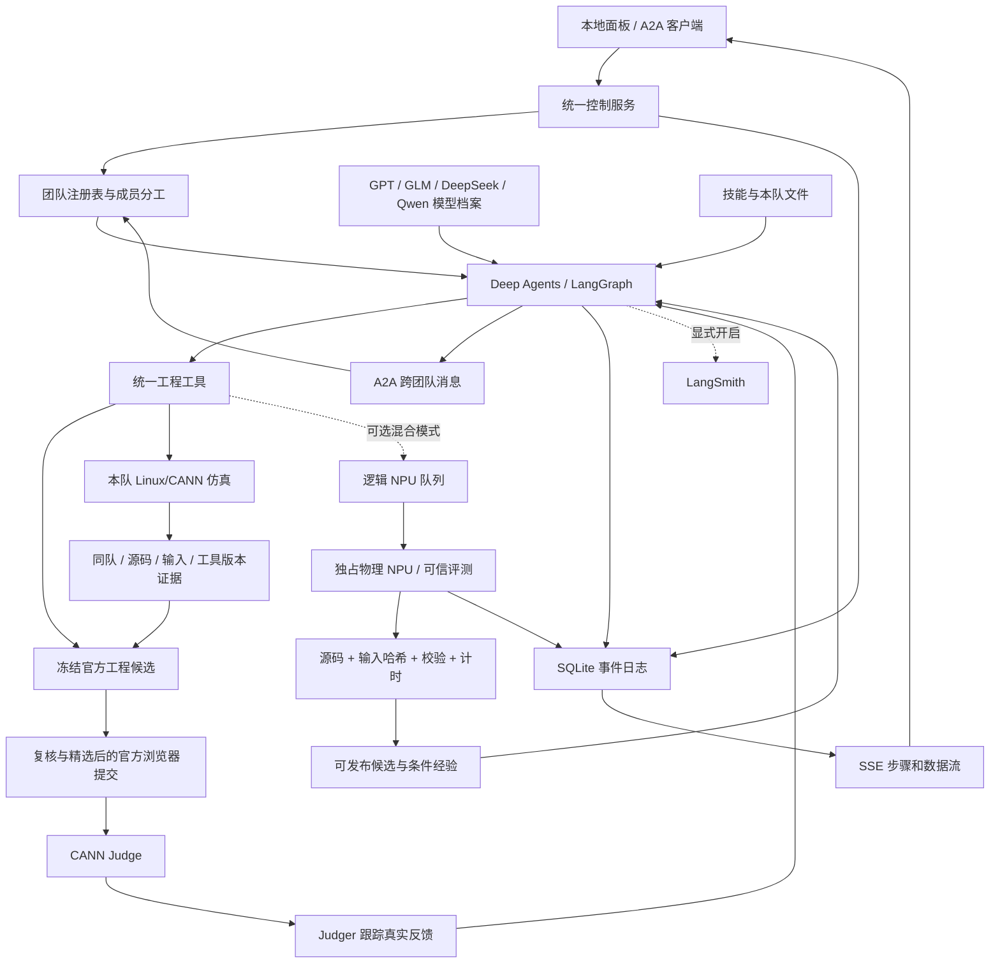

# 系统设计

默认运行路径已改为 **ConfusionMulGrad / judge-only**：模型队列、官方工程冻结、公开榜单监控和提交反馈。参见 [无服务器真实 PK](judge-only.md)。下面的 NPU 路径是保留的可选混合模式；没有配置设备时不会运行 Profiler。各队已接入 Linux/CANN 独立编译与 910B4 仿真；仿真与官测证据分开保存。

## 强 Harness 的归属

每队协调者与子智能体均由 create_deep_agent 创建，使用模型工具循环、TodoList、原生文件工具、技能发现、子任务委派和 LangGraph 检查点。每队独立 SQLite 检查点，避免多队首次初始化的锁冲突；旧共享会话用 SQLite backup 保留。模型提供商共享同一套运行时。analyst / reviewer 只有文件读取工具；implementer 和主力可以修改源码并提交受控实验。成员模型可覆盖主力模型。

团队成员在一次任务开始时形成图，任务结束后可改组或退出。团队间是 A2A 消息投递与公开成果学习；不会因发送消息自动为接收团队启动一个付费模型任务。不同团队的私有工作区不在其他团队文件工具的虚拟根目录内。

## 三项核心技术在当前实现中的边界

- 蜂群搜索：注册最多 100 队，独立工作区与模型会话，共享已发布成果；当前硬件只验收 1 卡，不代表百队性能或收敛性已经验证。
- 经验蒸馏：模型从证据提取条件、动作、局限与来源作业，必须绑定当前通过的代码 / 输入。支持跨算子假设字段；尚无第二个算子验证迁移收益。
- 稀疏结构感知：已保留技能 / 工具扩展位置和面板说明，当前 ConfusionMulGrad 没有接入经验证的稀疏算法或宣称稀疏加速。

## 真实步骤

stage.updated 使用 input / search / policy / queue / execute / verify / share / distill。未收到真实事件的步骤保持未执行。工具事件记录 team、run_id、agent、tool_call、参数和结果摘要；设备事件来自可信 runner 的编译与逐点评测。每条事件有递增 seq，可断线续传和导出。完整源码 / 编译日志 / 结果文件位于本机 jobs 目录；工具大输出会截断并标记。

## 调度与取消

SQLite 事务、唯一运行设备索引和随机租约 token 保证同一物理卡不会被两个作业同时领取。同队也不能同时占用多张卡。FIFO 跳过已经占卡的团队，最多允许 8 个持卡团队。ServerRegistry 保存多台 SSH 配置，活动连接登记 1–8 张卡，RemoteRunner 按租约路由到对应设备。当前一次使用一台主机；多主机同时汇池是后续扩展项。

停止模型任务只取消模型 / 图执行，已经开始的评测由 shield 继续收尾。关闭服务会等待物理实验完成。网络异常时远程 flock 与进程超时继续约束设备访问；恢复作业前仍需核实远程进程。异常断电可能留下需要人工核实的活动租约。一个数据目录只运行一个控制服务，避免重复会话。

## 可信程度

源码静态检查拦截部分明显违规，不代替全部规则的证明。可信 evaluator 与候选分离，候选不修改计时和精度；当前评测依然会执行用户提供的 C++ Host 代码，不能作为恶意多租户判题沙箱。安全边界见 SECURITY.md。

## 面板配置与算子隔离

模型 API、SSH 连接由本机私有注册表维护；API Key、密码、私钥口令使用 Fernet 加密，不进入模型上下文。设置助手与团队优化分别记录任务；算子助手仅提交草稿，服务器助手仅使用可信探测和已发现配置。浏览器终端通过同源 WebSocket 与实际 SSH PTY 通信。

OperatorCatalog 将新增包放在独立目录，继承默认约束并固定评测文件清单及哈希。每个包绑定独立 LabStore、团队源码和检查点；未确认其专属评测器时，evaluate_kernel 返回诊断。配置切换要求当前实验与模型任务完成，避免把旧任务写入新算子。
